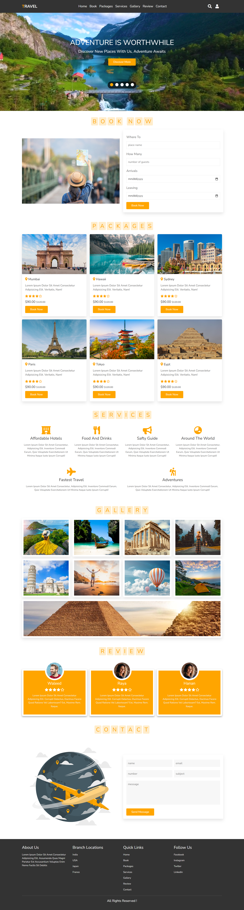

<p align="center">
  <h1 align="center">✈️ Travel — Responsive Travel Website</h1>
</p>

<p align="center">
  <em>A modern, elegant, and fully responsive travel agency website — built with HTML, CSS & Bootstrap 5.</em>
</p>

<p align="center">
  
  
  
  
  
  
</p>

<p align="center">
  <a href="#-application-demo-">🎥 Application Demo</a>
  &nbsp;&nbsp;|&nbsp;&nbsp;
  <a href="#-screenshots-️">📸 Screenshots</a>
</p>

---

## 📖 Project Description

**Travel** is a premium, pixel-perfect responsive travel agency website. Built with **HTML5, CSS3, JavaScript & Bootstrap 5** — showcasing clean, semantic markup combined with powerful CSS techniques and a responsive layout.

The website features a stunning hero section with a video slider, booking functionality, travel packages showcase, services section, dynamic image gallery, client reviews, a contact form, and a fully responsive layout that adapts beautifully from desktop to mobile.

> 💡 **Why this project stands out:** It demonstrates advanced front-end development skills including video sliders, responsive flexbox and grid layouts, interactive forms, smooth scrolling navigation, and a cohesive design system — all tailored for a modern travel agency.

---

## 🎥 Application Demo 🎬

<div align="center">
  <video src="https://github.com/user-attachments/assets/81103845-ebbd-40a5-8370-8b2a95a16d59" width="100%" style="max-width: 800px;" controls="controls" muted="muted"></video>
</div>

---

## 📸 Screenshots 🖼️

<div align="center">
  <table>
    <tr>
      <th align="center">Screen</th>
      <th align="center">🖥️ Desktop View</th>
      <th align="center">📱 iPad Pro</th>
      <th align="center">📲 iPhone 14 Pro Max</th>
    </tr>
    <tr>
      <td align="center"><strong>Landing Page</strong></td>
      <td align="center"></td>
      <td align="center"></td>
      <td align="center"></td>
    </tr>
  </table>
</div>

---

## 📖 Table of Contents

- [📸 Screenshots](#-screenshots-️)
- [🛠️ Technologies & Styles Used](#️-technologies--styles-used-)
- [✨ Core Features](#-core-features)
- [🗺️ Application Sections](#️-application-sections)
- [📂 Folder Structure](#-folder-structure)
- [🚀 Installation Instructions](#-installation-instructions)
- [💻 How to Run the Development Server](#-how-to-run-the-development-server)
- [🚀 Future Improvements](#-future-improvements)

---

## 🛠️ Technologies & Styles Used 🎨

| Technology | Purpose | Details |
|:---:|:---|:---|
|  | **Structure** | Semantic HTML5 elements (`<nav>`, `<header>`, `<section>`, `<footer>`) |
|  | **Styling** | Advanced CSS3 with Flexbox, grid layouts, transitions & media queries |
|  | **Interactivity** | Mobile menu toggling, video slider controls, smooth scrolling |
|  | **Framework** | Responsive layout utilities and styling |
|  | **Icons** | Navigation, services, and social media icons |

---

## ✨ Core Features

<table>
  <tr>
    <td width="50%">

### 🎯 User Interface
- ✅ **Fixed Navigation Bar** with smooth scrolling to sections
- ✅ **Video Slider Background** in the hero section
- ✅ **Responsive Hamburger Menu** for mobile screens
- ✅ **Interactive Search & Login overlays**

    </td>
    <td width="50%">

### 📱 Responsive Design
- ✅ **Fluid Layouts** using Flexbox and Bootstrap
- ✅ **Media Queries** to ensure pixel-perfect rendering on all devices
- ✅ **Responsive Images & Videos** that scale according to screen size
- ✅ **Adaptive Typography**

    </td>
  </tr>
  <tr>
    <td width="50%">

### 💼 Travel Features
- ✅ **Interactive Booking Form** (Where to, Guests, Dates)
- ✅ **Travel Packages** with pricing and star ratings
- ✅ **Services Highlights** (Hotels, Food, Safety, World Tours)
- ✅ **Image Gallery** showcasing beautiful destinations
- ✅ **Client Reviews** section with testimonials

    </td>
    <td width="50%">

### 🎬 Animations & Effects
- ✅ **Hover Transitions** on buttons and cards
- ✅ **Video Autoplay** background in home section
- ✅ **Loading Screen Animation** using a loader GIF
- ✅ **Smooth Reveal Effects** for sections

    </td>
  </tr>
</table>

---

## 🗺️ Application Sections

The website is organized into the following sections:

```text
┌─────────────────────────────────────────────┐
│  🔝 Header & Navigation                     │
│  ├── Logo                                   │
│  ├── Menu: Home|Book|Packages|Services...   │
│  ├── Icons: Search, Login                   │
│  └── Mobile Hamburger Menu                  │
├─────────────────────────────────────────────┤
│  🏠 Home Section                            │
│  ├── Hero Text & CTA Button                 │
│  ├── Video Background Slider                │
│  └── Slider Controls                        │
├─────────────────────────────────────────────┤
│  📅 Book Section                            │
│  ├── Booking Form (Destination, Dates)      │
│  └── Illustrative Image                     │
├─────────────────────────────────────────────┤
│  ✈️ Packages Section                        │
│  └── 6 Travel Destination Cards             │
├─────────────────────────────────────────────┤
│  🛠️ Services Section                        │
│  └── 6 Service Highlights with Icons        │
├─────────────────────────────────────────────┤
│  🖼️ Gallery Section                         │
│  └── Responsive Image Grid (9 Images)       │
├─────────────────────────────────────────────┤
│  ⭐ Review Section                          │
│  └── Client Testimonials                    │
├─────────────────────────────────────────────┤
│  ✉️ Contact Section                          │
│  ├── Contact Form                           │
│  └── Illustrative Graphic                   │
├─────────────────────────────────────────────┤
│  📋 Footer                                   │
│  ├── About Us Info                          │
│  ├── Branch Locations                       │
│  ├── Quick Links                            │
│  └── Social Media Links                     │
└─────────────────────────────────────────────┘
```

---

## 📂 Folder Structure

```text
travel-website-with-team/
│
├── 📄 index.html               # Main entry point
├── 📄 README.md                # Project documentation
│
├── 📁 assets/
│   ├── 📁 css/                 # Custom styling
│   │   └── 🎨 style.css
│   ├── 📁 img/                 # Images used across the site
│   ├── 📁 js/                  # Interactivity scripts
│   │   └── 📄 script.js
│   └── 📁 video/               # Background videos for hero section
│
├── 📁 vendor/                  # Third-party vendor files
└── 📁 webfonts/                # Local font files
```

---

## 🚀 Installation Instructions

### Prerequisites

- Any modern web browser (Chrome, Firefox, Safari, Edge)
- A code editor (VS Code recommended)

### Steps

**1. Clone the repository:**

```bash
git clone <your-repository-url>
```

**2. Navigate to the project directory:**

```bash
cd travel-website-with-team
```

**3. Open in your browser:**

```bash
# Simply open the index.html file in your browser
```

---

## 💻 How to Run the Development Server

While you can open `index.html` directly, using a live server provides auto-reload on file changes:

### VS Code Live Server (Recommended)

```text
1. Install the "Live Server" extension in VS Code
2. Right-click on index.html
3. Select "Open with Live Server"
4. Browser opens at http://127.0.0.1:5500
```

---

## 🚀 Future Improvements

- [ ] 🌙 **Dark Mode Toggle**
- [ ] 🗺️ **Interactive Maps Integration**
- [ ] 💳 **Payment Gateway for Booking**
- [ ] ♿ **Accessibility Improvements (a11y)**
- [ ] 🌐 **Multi-language Support**

---

<p align="center">
  <strong>Made with ❤️ by the Team</strong>
</p>
